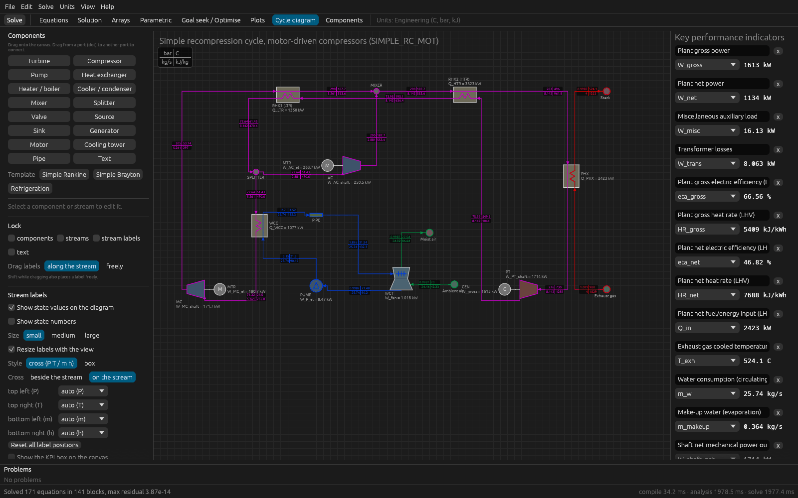
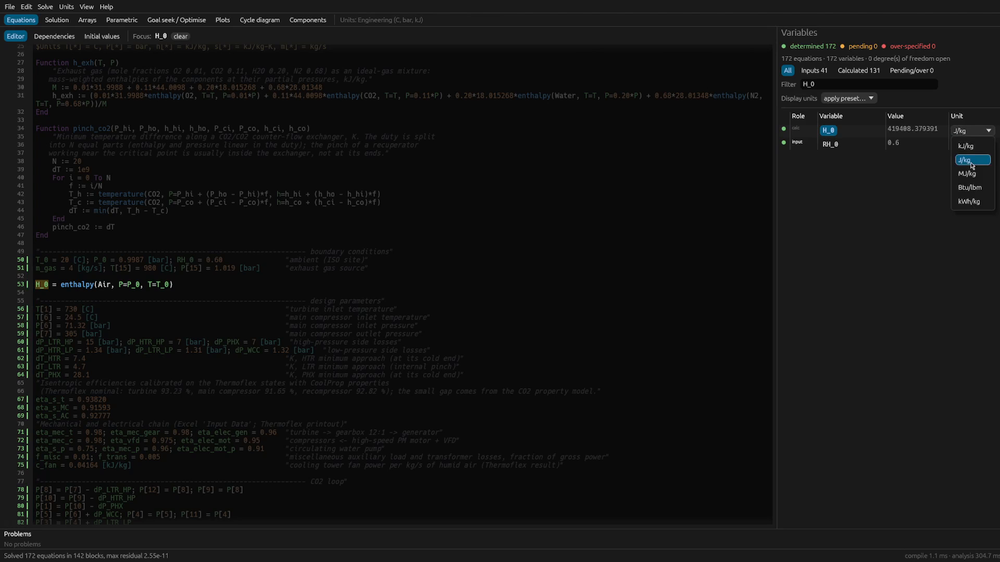
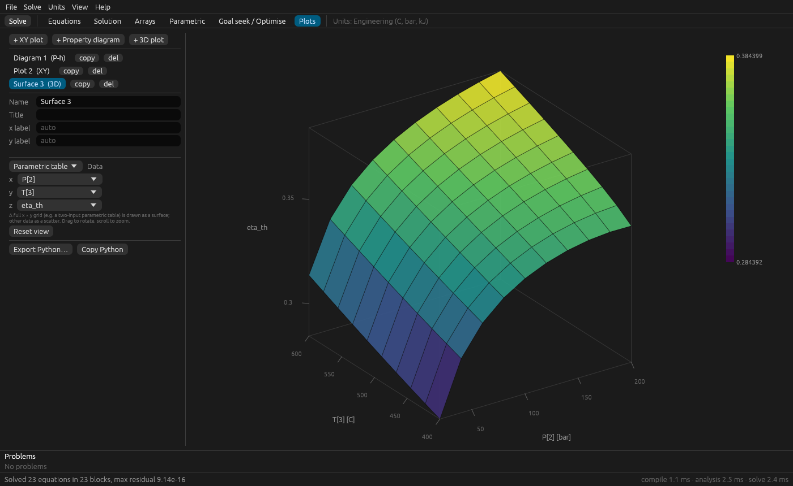
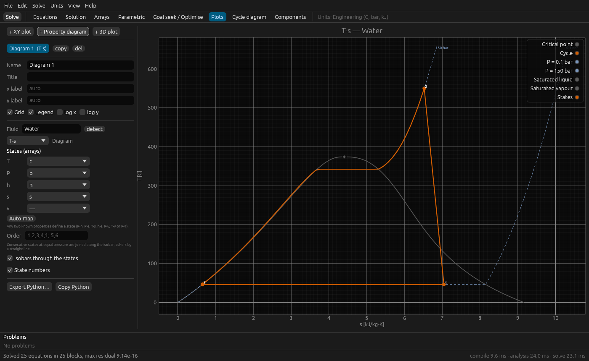
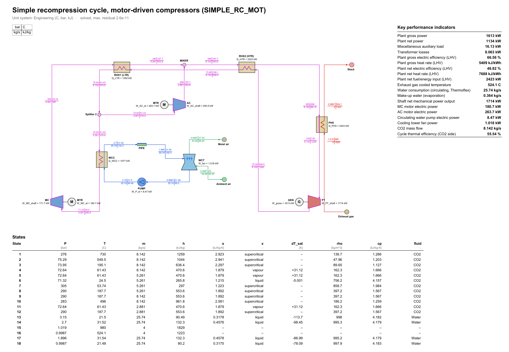

<p align="center">
  
</p>

<h1 align="center">DeltaF Studio</h1>

<p align="center">
  <b>Write the equations. DeltaF Studio works out the rest.</b><br>
  A free, open-source equation solver for engineering models, with
  thermodynamic properties and cycle tools built in.<br>
  <sub>Formerly DF Studio.</sub>
</p>

<p align="center">
  <a href="https://github.com/dafer238/dfstudio/releases/latest"></a>
  <a href="https://github.com/dafer238/dfstudio/actions/workflows/ci.yml"></a>
  <a href="LICENSE"></a>
  
</p>



DeltaF Studio solves systems of nonlinear algebraic equations written in any
order, the way you would write them on paper. Type an energy balance, an
efficiency definition and a few property calls, and DeltaF Studio finds which
equation determines which variable, solves the system, and keeps the
results in sync with tables, plots and a flowsheet of your cycle.

## Download

| System | Package |
|---|---|
| **Windows** 10/11 (x64) | [Installer `.exe`](https://github.com/dafer238/dfstudio/releases/latest): installs for all users (Program Files) or, without administrator rights, for you only. A portable `.zip` is also available. |
| **macOS** 11+ (Apple silicon and Intel) | [Universal `.dmg`](https://github.com/dafer238/dfstudio/releases/latest). First launch: right-click the app and choose *Open*. |
| **Linux** (x86-64, glibc 2.38+: Ubuntu 24.04, Debian 13, Fedora 39 or newer) | [`.AppImage`](https://github.com/dafer238/dfstudio/releases/latest): `chmod +x` and run. |

Each package includes the desktop app, the `dfs` command-line solver, the
CoolProp property library and example projects (Rankine, simple and
recuperated Brayton, and refrigeration cycles), each with its flowsheet, a
parametric study, a goal seek or optimisation and plots. No account, licence key or internet connection is
needed.

Windows releases are being set up for code signing through the SignPath
Foundation; see the [code signing policy](CODE_SIGNING.md).

## Highlights

**Know what is solvable before you solve.** The model is analysed as you
type. Every variable is coloured: green when the equations determine it,
orange when more equations are needed, red when it is over-specified. The
header tells you how many degrees of freedom are still open, and which
variables they are.

[](https://deltafstudio.com/assets/video/editor-sco2.mp4)

*Click the image to watch the 46-second recording.*

**See how your model is solved.** *Equations > Dependencies* shows the solve
order: which equations are evaluated directly, which are solved together in a
Newton block, how many iterations each block took and its residual. When a
model fails, the message names the block and the variables that did not
converge.

![Dependency view of the supercritical CO₂ model: how h[20] is computed, the variables it reads and its place in the solve order of 142 blocks](docs/img/dependencies-sco2.png)

**A solver you can read.** Exact derivatives (automatic differentiation of
your equations and the analytic derivatives of the equations of state),
block decomposition of the system, Newton's method with line search and a
Levenberg–Marquardt fall-back. Every step, tolerance and reference is
documented in [How DeltaF Studio solves a model](docs/HOW_IT_WORKS.md), and the
code is open. [Verification](docs/VERIFICATION.md) lists the tests against
IAPWS, NIST-JANAF and closed-form solutions that run on every change, and a
model for cross-checking with EES.

**Real-fluid properties included.** Water, CO₂, refrigerants, air and over a
hundred other fluids and mixtures through [CoolProp](http://www.coolprop.org),
plus ideal gases with thermochemical reference states (for combustion),
humid air, molten salts, liquid metals and thermal oils. Inputs CoolProp
cannot take directly, such as temperature with enthalpy, are solved for you.

**Flowsheets bound to the equations.** Draw the cycle (turbines,
compressors, pumps, heat exchangers, mixers, valves, cooling towers, ...)
or start from a template. Each stream shows the state values of the current
solution, and a double-click on a component opens its report: balances,
isentropic efficiency, pinch analysis and UA of heat exchangers, T–Q
diagrams, entropy generation and exergy destruction.

**Studies without scripting.**
* Parametric tables solved **in parallel** on all CPU cores.
* Goal seek and multi-variable matching (vary X and Z until Y₁ = Y₂ and
  W = 5 MW).
* Optimisation: Brent, Nelder–Mead or **global** differential evolution.
* Control loops written in the model: `$Control vary P[2] to make T[4] = 540`.



**Publication-ready output.**
* T–s, P–h, h–s, P–v and T–h diagrams with the saturation dome and your
  cycle on top; XY and 3D plots.
* *Export Python* writes a self-contained matplotlib script (SciencePlots
  style when installed) with the data
  embedded, for vector figures in papers and theses.
* A vector **PDF report** (flowsheet, KPIs, state table) written directly,
  without LaTeX or any other tool.





**Projects that travel.** A `.df` file holds the equations, units, studies,
plots, flowsheet, last solution and any attached data or images in one
checksummed file that opens identically on another computer. Equations can
also be kept as plain `.dfs` text for version control.

**Automate it.** The `dfs` command line solves models in batch or in CI,
and the `dfpy` Python package reads `.df` projects into numpy and pandas.

**Units handled for you.** Choose a unit system (°C/bar/kJ, SI, imperial or
custom), write `10 [bar]` or `25 [C]` anywhere, and show each variable in
its own display unit. Dimensions are inferred from the equations, so only
compatible units are offered, and inconsistent equations are flagged.

**Bring your existing models.** EES files (`.ees`, text and binary) open
directly, so models written for EES run without retyping. See
[Migrating from EES](docs/MIGRATING_FROM_EES.md).

## A first model

```text
"Simple Rankine cycle"
$UnitSystem Eng

P[1] = 0.1 [bar];  x[1] = 0
P[2] = 150 [bar];  T[3] = 550 [C]
P[3] = P[2];       P[4] = P[1]
eta_p = 0.85;      eta_t = 0.88;   m_dot = 50 [kg/s]

h[1] = enthalpy(Water, P=P[1], x=x[1])
s[1] = entropy(Water, P=P[1], x=x[1])
h_s[2] = enthalpy(Water, P=P[2], s=s[1])
eta_p = (h_s[2] - h[1]) / (h[2] - h[1])
h[3] = enthalpy(Water, P=P[3], T=T[3])
s[3] = entropy(Water, P=P[3], T=T[3])
h_s[4] = enthalpy(Water, P=P[4], s=s[3])
eta_t = (h[3] - h[4]) / (h[3] - h_s[4])

W_net = m_dot*((h[3] - h[4]) - (h[2] - h[1]))
eta_th = W_net / (m_dot*(h[3] - h[2]))
```

Press **F2**: `eta_th = 0.3706` and `W_net = 60 056 kW`. `h[2]` and `h[4]`
are never assigned: DeltaF Studio finds them from the efficiency definitions.
The [user guide](docs/USER_GUIDE.md#2-a-first-model-in-five-minutes)
continues from here.

## Documentation

| Document | Contents |
|---|---|
| [User guide](docs/USER_GUIDE.md) | Installing, writing models, units, studies, plots, cycle diagrams, files, shortcuts |
| [Language reference](docs/LANGUAGE.md) | Equations, arrays, functions and procedures, property functions, directives |
| [How it works](docs/HOW_IT_WORKS.md) | Structural analysis, Newton method, tolerances, derivatives, properties, studies, verification, references |
| [Architecture](docs/ARCHITECTURE.md) | Code organisation, design decisions, `.df` file format, packaging |
| [Migrating from EES](docs/MIGRATING_FROM_EES.md) | Running existing EES models, differences and checklist |
| [Building and releasing](docs/BUILDING.md) | Building from source and making the installers |

## Build from source

Requires [Rust](https://rustup.rs) 1.85 or newer. CoolProp is downloaded as a
prebuilt library by the `coolprop-sys` crate.

```bash
git clone https://github.com/dafer238/dfstudio
cd dfstudio
cargo run --release -p dfapp                       # desktop app
cargo run --release -p dfcli -- run examples/rankine.dfs
cargo test --workspace
```

On Linux the app needs the usual X11/Wayland and OpenGL libraries
(`libxkbcommon-x11`, `libgl1`). Installers are built as described in
[BUILDING.md](docs/BUILDING.md).

## Contributing

Bug reports, models that fail to solve, and pull requests are welcome; see
[CONTRIBUTING.md](CONTRIBUTING.md).

## Support the project

DeltaF Studio is free software and will stay free software under the AGPL-3.0.
Personal, academic and educational use is and will remain free of charge.

Commercial use is not restricted in any way. If you or your organisation use
DeltaF Studio for paid work, please consider paying for it, once or by
subscription; it funds maintenance, verification against reference data and
new features. This is a request, not a condition of the licence (see
[License](#license)).

- [GitHub Sponsors](https://github.com/sponsors/dafer238): monthly or
  one-time, through a GitHub account.
- Stripe, by card and other methods, without a GitHub account:
  [one-time payment](https://deltafstudio.com/pay/once) (you choose the
  amount), [monthly](https://deltafstudio.com/pay/monthly) or
  [yearly](https://deltafstudio.com/pay/yearly) subscription.
  Invoices, payment method and cancelling:
  [manage a subscription](https://deltafstudio.com/pay/manage).

The same options are in the app under *Help > Support DeltaF Studio* and on
[the website](https://deltafstudio.com/#support).

## License

DeltaF Studio is free software under the
[GNU Affero General Public License v3.0](LICENSE). Third-party components and
their licences (CoolProp: MIT; egui and the other Rust crates: MIT or
Apache-2.0) are listed in [THIRD_PARTY_NOTICES.md](THIRD_PARTY_NOTICES.md).

The AGPL-3.0 allows commercial use. A term that restricted it would be a
"further restriction", which section 10 of the licence forbids and section 7
lets any recipient remove. The request to commercial users above is therefore
not part of the licence and does not limit any right it grants.

EES is a product of F-Chart Software. DeltaF Studio is an independent project
and is not affiliated with F-Chart Software.
